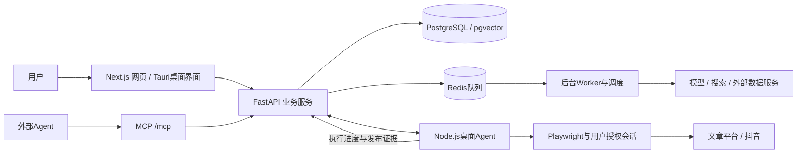

# 智心AI Community · 内容创作与多平台发布工作台

智心AI将知识资料、AI文章创作、媒体账号授权、文章与视频发布、结果回查及SEO/GEO分析整合到一个工作流中。网页端负责管理，服务端负责数据与调度，Windows桌面端使用用户授权的浏览器会话执行平台操作；外部Agent也可以通过MCP接入发布流程。

> MIT开源社区版，来自2026-11-07功能快照。没有原私有仓库历史、生产连接信息或用户数据。需要自行配置外部服务并构建桌面端。

[功能与平台](#功能与平台) · [架构](#架构) · [使用流程](#使用流程) · [本地开发](#本地开发) · [生产部署](#生产部署) · [测试与维护](#测试与维护) · [文档导航](#文档导航)

## 功能与平台

| 功能 | 用途与边界 |
| --- | --- |
| AI创作 | 文章生成、分步精修、编辑，以及知识库、素材、规则、模板和水印管理；实际生成需要配置模型服务 |
| 内容管理 | 管理文章、配图、发布记录与失败任务，关联内容和平台结果 |
| 媒体账号 | 在桌面端完成平台登录，采集登录证据，绑定当前智心AI用户及执行设备 |
| 文章发布 | 多平台任务调度、配图处理、提交与公开链接回查；平台审核和账号限制仍由各平台决定 |
| 抖音视频 | 视频素材、独立标题和简介、立即/定时发布及结果回查；定时需账号和设备能力满足要求 |
| SEO/GEO | 站点、关键词、排名、竞品、品牌资料、收录与GEO分析等页面及相关任务；外部数据依赖服务商配置 |
| 自动化接入 | 用户独立创建、授权、过期和撤销MCP凭据；外部Agent调用文章/视频发布工具 |
| 运维与诊断 | 任务状态、设备心跳、队列恢复、失败证据、签名适配器更新和备份恢复脚本 |

### 平台范围

| 内容类型 | 已实现适配器 |
| --- | --- |
| 文章 | 知乎、百家号、搜狐号、CSDN、网易号、企鹅号、头条号、简书 |
| 视频 | 抖音 |
| 微信公众号 | 尚未实现可用发布适配器，代码占位不代表支持 |

支持适配器不代表任何账号和内容都能发布成功。验证码、实名要求、内容审核、平台限流、账号处罚及页面变化都可能阻断流程。视频定时发布不是文章平台的通用能力。

## 架构



- **网页端**：Next.js App Router、React、TypeScript、Tailwind。主要业务请求由`/api/*`转发至FastAPI；仍保留部分上传代理等Next.js路由，并非完全没有服务端路由。
- **服务端**：Python 3.11+、FastAPI、SQLAlchemy；PostgreSQL保存业务数据，Redis承载任务队列。Worker执行生成、分析、调度及回查等后台工作。
- **桌面端**：Tauri外壳、Node.js执行器与Playwright浏览器。登录态采集和平台执行依赖桌面环境，网页服务正常不等于桌面执行器在线。
- **MCP**：复用用户权限、素材及持久发布队列，不向外部Agent开放平台Cookie、任意脚本或通用浏览器控制。
- **文件存储**：文章上传和私有视频素材使用独立目录/卷；数据库、Redis及上传内容需要持久化。

### 任务与结果判定

1. 用户在网页或MCP创建任务，服务端校验账号、设备、权限和输入。
2. 任务持久化并进入调度；平台操作交由同用户绑定的桌面执行器处理。
3. 适配器上传素材、准备编辑器并提交，回传状态与证据。
4. 系统按平台能力继续检查审核状态、作品列表或公开页面。

**命令执行成功、平台受理、审核中、公开发布成功是不同状态。** 遇到提交结果不明，应先回查作品，避免盲目重试造成重复投稿。HTTP页面可访问也不能当作搜索引擎收录证据。

## 使用流程

### 1. 登录并绑定桌面端

注册时使用邮箱验证码，之后使用邮箱和密码登录。管理员可关闭新用户注册，不影响现有用户登录。

安装并打开Windows桌面端，用同一个智心AI账号登录，完成设备与用户绑定。保持桌面端运行且网络可用；只有浏览器网页在线不足以执行桌面发布任务。

### 2. 授权媒体账号

进入媒体账号管理，选择平台，在弹出的平台窗口中完成登录及必要验证。以智心AI显示账号授权有效为准，不以平台页面显示已登录作为唯一成功依据。

抖音授权需要账号身份、有效登录凭据和创作工作台证据。多账号应分别授权；执行发布前还会核对目标账号，避免用错账号投稿。

### 3. 创作和发布文章

1. 配置可用模型服务，准备知识资料、素材及创作规则。
2. 在AI创作中生成或编辑文章，检查正文与配图。
3. 选择已授权的平台账号，创建发布任务。
4. 在任务、失败中心或发布记录查看结果；待审核及结果不明的任务先回查，不直接重复提交。

### 4. 发布抖音视频

上传视频素材，选择账号，填写作品标题和简介，按界面选择立即或定时发布。定时发布受平台、账号和桌面能力门禁限制；MCP定时时间须带时区、精确到分钟，当前窗口为未来2小时至14天。

任务提交后继续查看最终状态。AI封面、话题、章节等准备能力受当前平台界面及素材条件影响，不能将编辑完成当作发布成功。

### 5. 通过MCP接入外部Agent

登录网页的“自动化接入”页面（`/agent-access`），为客户端创建独立凭据。默认只读；文章与视频写权限分别授权。明文凭据只展示一次，用环境变量保存。

```toml
# Codex config.toml
[mcp_servers.zhixin-ai]
url = "https://your-domain.example/mcp"
bearer_token_env_var = "ZHIXIN_MCP_TOKEN"
```

自部署时替换为自己的HTTPS域名。发布调用需要明确确认和幂等键，并要求同用户绑定的桌面端在线。详细权限、上传步骤、工具参数及错误码见[远程MCP文档](docs/remote-mcp.md)。

## 获取源码

克隆此仓库或使用GitHub的Download ZIP，再按[私有化部署指南](docs/source-release-guide.md)配置。该仓库不复用原私有发行包。

## 本地开发

### 环境要求

- Node.js 20及以上、npm；仓库使用npm workspaces及`package-lock.json`。
- Python 3.11及以上，用于API和Worker宿主机开发。
- Docker Desktop / Docker Compose v2，用于PostgreSQL、Redis及完整开发栈。
- Windows桌面端打包另需Rust、Tauri 1.x构建依赖、WebView2和Inno Setup 6。

### 方案A：Docker完整栈

在仓库根目录执行以下PowerShell命令。已有配置时保留原文件，不要用示例覆盖：

```powershell
npm ci
if (!(Test-Path apps/api/.env)) { Copy-Item apps/api/.env.example apps/api/.env }
# 编辑 apps/api/.env，填写所需模型和外部服务配置
npm run dev:docker
npm run verify:docker
```

默认网页地址为`http://127.0.0.1:3001`，API为`http://127.0.0.1:8000`。端口冲突可使用`npm run dev:docker:alt-web`，对应网页3002、API 8001。

| 命令 | 用途 |
| --- | --- |
| `npm run dev:services` | 只启动PostgreSQL和Redis |
| `npm run docker:build` | 构建API、Worker、Web镜像 |
| `npm run docker:up` | 启动已有镜像 |
| `npm run docker:ps` | 查看服务状态 |
| `npm run dev:docker:logs` | 查看服务日志 |
| `npm run docker:down` | 停止服务，保留持久卷 |

本地后端配置来源是`apps/api/.env`；Compose覆盖容器内数据库、Redis及存储地址。根目录`.env.example`不是完整生产配置，端口覆盖示例另见[.env.docker.example](.env.docker.example)。

### 方案B：宿主机开发

先在根目录运行`npm ci`与`npm run dev:services`，然后分别启动三个终端。

API终端：

```powershell
cd apps/api
python -m venv .venv
.\.venv\Scripts\Activate.ps1
python -m pip install -e ".[dev]"
if (!(Test-Path .env)) { Copy-Item .env.example .env }
python -m uvicorn app.main:app --reload --host 127.0.0.1 --port 8000
```

Worker终端（同样激活API虚拟环境）：

```powershell
cd apps/api
.\.venv\Scripts\Activate.ps1
python -m app.worker_cli --queues default,publish,index,media,knowledge,seo,ai --schedule --schedule-interval 60
```

网页终端（仓库根目录）：

```powershell
$env:FASTAPI_BASE_URL = "http://127.0.0.1:8000"
npm run dev
```

网页默认`http://127.0.0.1:3000`。API设置从当前工作目录的`.env`读取，因此宿主机API和Worker在`apps/api`内运行。调整其中`UPLOAD_DIR`为期望的绝对路径，避免相对路径随启动目录变化。若使用知识抓取的隐身浏览器能力，按后端依赖要求执行`scrapling install`安装浏览器。

### 配置说明

| 配置组 | 主要变量 |
| --- | --- |
| 数据与队列 | `DATABASE_URL`、`REDIS_URL`、`UPLOAD_DIR` |
| 文本生成 | `ARTICLE_TEXT_PROVIDER`及对应DeepSeek/Gemini服务配置 |
| 图片生成 | `ARTICLE_IMAGE_PROVIDER`及对应Step/Gemini服务配置 |
| 注册与登录 | `AUTH_REGISTRATION_ENABLED`、`AUTH_EMAIL_DELIVERY`、`AUTH_COOKIE_SECURE`、SMTP配置 |
| 搜索与收录 | DataForSEO、Google Search Console、百度推送、IndexNow等对应凭据 |
| 网页代理 | `FASTAPI_BASE_URL` |

本地可用`AUTH_EMAIL_DELIVERY=console`查看注册验证码；生产使用SMTP，并设置`AUTH_DEBUG_RETURN_CODE=false`、`AUTH_COOKIE_SECURE=true`。生产关闭模拟发布（`MEDIA_PUBLISH_FALLBACK_MOCK=false`），不能将开发模拟结果作为真实发布证据。

### 桌面开发与打包

社区版桌面默认连接`http://127.0.0.1:3001`。私有HTTPS部署需修改UI/Agent/CSP地址。先运行`node scripts/setup-community-signing.mjs`生成自己的验签公钥与本地私钥；原项目公钥和下载清单未分发。CSDN网关需在桌面进程环境配置`CSDN_ARTICLE_APP_KEY`、`CSDN_ARTICLE_APP_SECRET`、`CSDN_UPLOAD_APP_KEY`、`CSDN_UPLOAD_APP_SECRET`，未配置时明确拒绝网关调用。

```powershell
npm --prefix apps/desktop run install-browsers
npm --prefix apps/desktop run tauri:dev
# 安装构建依赖后生成Windows安装包
npm --prefix apps/desktop run build:installer
```

桌面Agent默认连接线上地址。连接本地服务时应显式设置`ZHIXIN_API_BASE_URL`，并用独立的`ZHIXIN_DESKTOP_STATE`路径隔离测试设备状态，避免混用生产账号。

## 生产部署

推荐Linux服务器使用[docker-compose.prod.yml](docker-compose.prod.yml)，通过Nginx提供HTTPS访问。API和Web只绑定宿主机回环端口，PostgreSQL、Redis留在内部网络。

```bash
# 首次部署：复制后编辑，已有生产配置不要覆盖
cp .env.production.example .env.production
# 设置数据库/Redis密码、域名、SMTP、模型服务等配置后执行
docker compose --env-file .env.production -f docker-compose.prod.yml config --quiet
docker compose --env-file .env.production -f docker-compose.prod.yml up -d --build
docker compose --env-file .env.production -f docker-compose.prod.yml ps
```

示例文件含现有部署的域名和邮件服务示例，自部署必须替换。反向代理需正确转发网页、`/api/*`、`/mcp`、上传和下载入口；MCP需支持长连接。部署后检查`/health`、登录页面、API/Worker健康和桌面心跳，可使用[scripts/production/verify.sh](scripts/production/verify.sh)，并按实际路径设置`PROJECT_DIR`、`PUBLIC_URL`。

### 四种发布对象

| 对象 | 更新方式 |
| --- | --- |
| Web | 构建并发布Next.js镜像 |
| API / Worker | 发布后端镜像，核对实际运行版本与Compose声明 |
| 桌面程序 | 构建安装包并更新下载清单；核心执行器改动需要桌面升级 |
| 平台适配器 | 发布Ed25519签名的累积热更新包，校验最低桌面版本、依赖及客户端加载结果 |

适配器更新必须保留其他平台已上线文件，不能用单平台包覆盖整个集合。云端清单更新不代表客户端已加载；应以执行结果中的`adapterBundleVersion`等证据确认。热更新工具位于`apps/desktop/scripts`，实际构建结果需自行验收。

### 备份与恢复

[scripts/production/backup.sh](scripts/production/backup.sh)备份数据库、文章上传卷、环境配置与Compose配置，校验成功后执行保留策略：仅删除超过7天的完整备份，至少保留最近7份完整备份。

**当前脚本未覆盖独立的私有视频素材卷，也未备份桌面浏览器资料及热更新签名私钥。** 这些数据需另行制定受控备份；不能将脚本生成的备份称为全系统完整备份。清理脚本还使用固定生产Postgres容器名，自部署变更项目名时需同步检查。

恢复工具为[scripts/production/restore.sh](scripts/production/restore.sh)与[restore-drill.sh](scripts/production/restore-drill.sh)。先在隔离环境演练，保留当前生产镜像与可用备份，再执行正式恢复。

## 测试与维护

在仓库根目录执行：

```powershell
npm run typecheck
npm test
npm --prefix apps/desktop test
npm run build
```

后端测试在API目录及已安装开发依赖的虚拟环境中执行：

```powershell
cd apps/api
python -m pytest tests -q
```

`npm test`先执行乱码检查再运行Vitest；桌面测试单独运行。自动化测试通过不等于真实账号授权或平台投稿已通过验收。需要真实平台验证时明确目标账号、测试内容及清理方式。

| 现象 | 优先检查 |
| --- | --- |
| 网页500或加载异常 | API/Web日志、数据库连接、磁盘容量、静态资源及浏览器控制台 |
| 发布任务长期排队 | 目标设备心跳、用户绑定、执行器版本、Worker和队列状态 |
| 平台已登录但授权失败 | 强登录凭据、工作台就绪证据、实际加载的适配器版本 |
| 按钮不存在或不可点击 | 弹窗可见性、按钮启用状态、验证/审核提示及失败截图 |
| 已提交却未取得链接 | 先查作品列表和公开状态，勿直接再次提交 |
| 上传失败 | 具体HTTP错误、请求超时、文件限制、磁盘和存储目录 |

不要按任务年龄直接删除结果不明的发布记录；不要为解决按钮禁用而强制点击或取消登录证据校验。日志与截图也可能含账号或内容信息，分享前需脱敏。

## 仓库结构

```text
apps/
  api/                  FastAPI、认证、MCP、任务、平台业务与后端测试
  desktop/              Tauri、Node Agent、Playwright适配器、安装及热更新工具
  web/                  Next.js界面、上传代理、桌面桥接及前端测试
packages/core/          共享类型、导航和业务辅助逻辑
scripts/               本地Docker工具、生产验证与备份恢复
docs/                  接入协议、设计记录、发布与专项说明
docker-compose.yml     本地开发栈
docker-compose.prod.yml 生产服务编排
```

真实`.env`、密钥、媒体平台登录态、数据库、上传素材及诊断输出不属于源码，不应提交Git。签名私钥与桌面用户状态应独立保护。

## 文档导航

- [远程MCP：用户接入、工具与权限](docs/remote-mcp.md)
- [桌面媒体授权协议](docs/desktop-media-auth-protocol.md)
- [本地API配置示例](apps/api/.env.example)
- [生产配置示例](.env.production.example)

架构与常用流程以本README作为入口；具体工具参数以接入文档和当前代码为准，历史发布记录不代表当前设备的实际运行状态。

## 许可证

本项目采用[MIT许可证](LICENSE)。第三方依赖保留其各自许可证，平台服务使用受平台条款约束。
