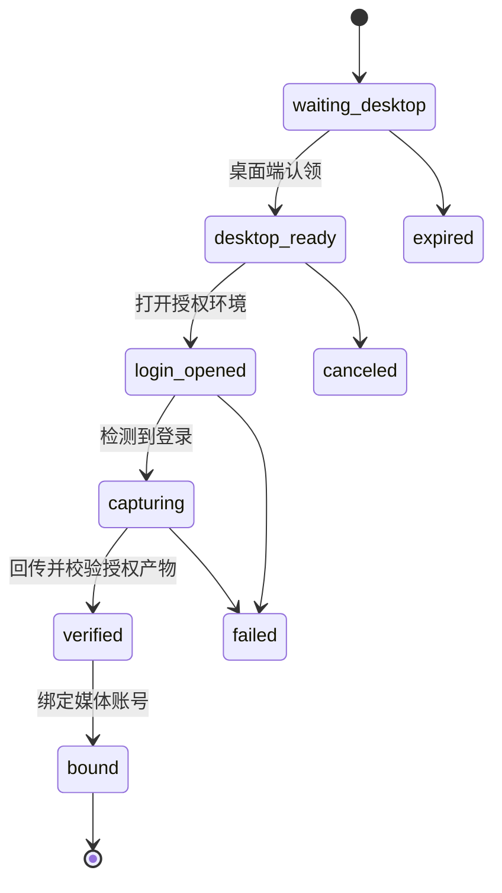

# 桌面端免费媒体授权协议

更新时间：2026-07-04

## 目标

补齐快鲸式免费媒体授权链路：

`Web 发起授权 -> 桌面端打开隔离授权环境 -> 用户登录平台 -> 桌面端采集登录态 -> 加密回传 API -> API 绑定媒体账号 -> 后续自动发布复用凭证`

协议只面向用户自己拥有或被授权运营的媒体账号。桌面端需要尊重目标平台规则、频率限制和账号安全策略。

## 核心对象

### desktopDevices

桌面端设备注册信息：

- `id`
- `deviceName`
- `platform`: `windows` / `macos` / `linux`
- `appVersion`
- `publicKey`
- `deviceTokenHash`
- `status`: `active` / `offline` / `revoked`
- `lastSeenAt`
- `createdAt` / `updatedAt`

### mediaAuthSessions

一次授权流程：

- `id`
- `platform`: `zhihu` / `baijiahao` / `sohu` / `wechat` / `other`
- `mediaAccountId`
- `deviceId`
- `pairingCode`
- `nonce`
- `status`: `waiting_desktop` / `desktop_ready` / `login_opened` / `capturing` / `verified` / `bound` / `failed` / `expired` / `canceled`
- `loginUrl`
- `expiresAt`
- `failureReason`

### mediaAuthArtifacts

桌面端回传的登录凭证产物：

- `sessionId`
- `mediaAccountId`
- `platform`
- `encryptedCookies`
- `encryptedLocalStorage`
- `encryptedSessionStorage`
- `fingerprint`
- `accountName`
- `avatar`
- `status`
- `lastVerifiedAt`

### mediaAccountBindings

授权结果与媒体账号的绑定关系：

- `mediaAccountId`
- `sessionId`
- `artifactId`
- `deviceId`
- `platform`
- `status`

### desktopCommands

Web/API 下发给桌面端的命令：

- `type`: `open_auth` / `verify_auth` / `publish_article` / `refresh_cookies`
- `deviceId`
- `mediaAccountId`
- `payload`
- `status`: `queued` / `running` / `succeeded` / `failed`
- `result`
- `errorMessage`

### desktopEvents

桌面端回传事件：

- `desktop_ready`
- `browser_opened`
- `login_detected`
- `capture_started`
- `artifact_submitted`
- `publish_started`
- `publish_succeeded`
- `publish_failed`
- `heartbeat`

## 状态流

## 已落地接口

- `POST /api/desktop-devices/register`
- `GET /api/desktop-devices`
- `POST /api/media-auth-sessions`
- `GET /api/media-auth-sessions/{session_id}`
- `POST /api/desktop-devices/{device_id}/media-auth-sessions/{session_id}/claim`
- `POST /api/desktop-events`
- `POST /api/media-auth-sessions/{session_id}/artifacts`
- `POST /api/media-auth-sessions/{session_id}/bind`
- `GET /api/desktop-commands`
- `POST /api/desktop-commands`
- `GET /api/desktop-commands/{command_id}`
- `POST /api/desktop-commands/{command_id}/events`

## 当前 MVP 能力

- Web `/free-media` 可创建授权会话、轮询状态、查看事件流。
- Desktop Agent 可注册设备、认领会话、回传授权产物、绑定账号。
- Desktop Agent 可执行发布命令并回传发布 URL。
- API 在发布成功后创建媒体订单和索引提交记录。
- Tauri UI 可调用本地 Agent 命令，显示连接状态、授权表单、发布命令和日志。

## 后续真实自动化

当前 adapter 是协议级占位实现。接入真实平台时按以下顺序：

1. 知乎：使用隔离浏览器 profile 打开登录页，检测登录态，采集允许域名下的 Cookie/localStorage/sessionStorage。
2. 百家号：补封面、正文、原创声明字段映射。
3. 搜狐号：补分类、正文编辑器适配。
4. 微信公众号：最后做，需要更严格的草稿、群发、扫码和风控处理。

## 验收标准

- Web 能创建授权会话并展示配对码。
- 桌面端能注册设备并保存 `deviceId/deviceToken`。
- 桌面端能认领会话、回传事件、提交授权产物。
- API 能保存授权产物并绑定媒体账号。
- Web 能看到媒体账号变为 active。
- Web 能下发发布命令。
- 桌面端能执行发布命令并回传 URL。
- API 能创建媒体订单和索引记录。
- 失败、过期、取消和重试都有状态与日志。
